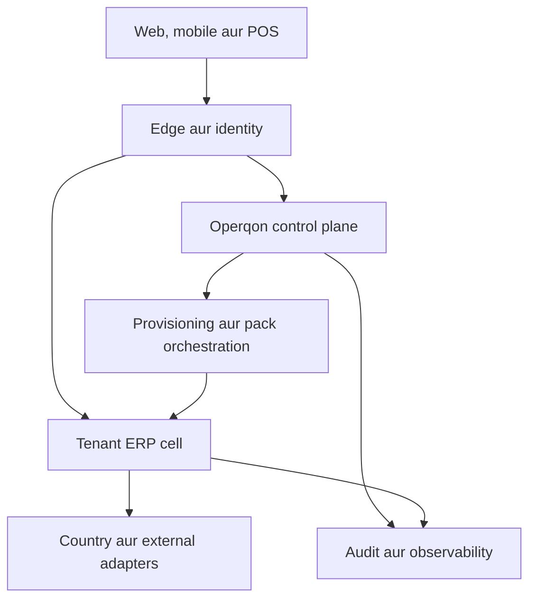

# Operqon: architecture aur domain model

Version: planning baseline 1.0 | Tareekh: 6 November 2026 | Status: proposed; implemented hone ka daawa nahin.

## 1. Architecture ka faisla

Operqon ko Frappe/ERPNext ke tested business engine par owned product banana chahiye. SaaS control plane, customer experience, pack registry, commercial catalogue aur deployment management Operqon ke apne bounded modules hon. Har feature ke liye naya service banana zaroori nahin: pehle modular control-plane application aur Frappe apps; sirf measurable isolation, scaling ya regulatory zaroorat par services alag ki jayein.

Frappe mein site apni database rakhta hai [ENG-03]. Is liye shuru ka tenancy model site-per-tenant ho. Shared bench cost bachata hai lekin process, CPU, deployment aur administrative trust boundaries share karta hai. Is ko dedicated compute jaisi isolation keh kar bechna ghalat hoga. Regulated ya noisy tenants ko alag cell/bench aur zaroorat par dedicated infrastructure diya jaye.



### Data ke malik

| Boundary | Asal record | Store | Kis ko direct write nahin karni |
|---|---|---|---|
| Identity | Credentials, subject ID, MFA | Keycloak | ERP aur portal password copy nahin rakhein |
| SaaS | Tenant request, subscription, entitlement, provisioning job | Control-plane PostgreSQL | Tenant ERP provider invoice settle na kare |
| Business | Customer, supplier, order, stock, GL, payroll | Tenant ERP database | Control plane direct SQL se transaction na banaye |
| Pack registry | Signed version, dependency, migrations, certification evidence | Versioned registry plus source repository | Tenant admin production package upload na kare |
| Documents | Tenant-scoped files, signed fiscal originals | Region-assigned object store | Public bucket ya shared predictable object key nahin |
| Reporting | Derived read models | Scoped analytics store | Analytics se transactional correction nahin |
| Integration | External reference, delivery attempt, acknowledgement | Adapter store plus domain event | Retry financial source ko duplicate na kare |

Source of truth aik hi jagah ho. SaaS subscription invoice aur tenant ki apne customers ko di hui invoice alag concepts hain; tax registrations, ledgers, invoice series aur payment webhooks bhi alag hon.

## 2. Existing stack ko preserve karna

Reported baseline: ERPNext v16, separate provider API R2.1, Keycloak, PostgreSQL control DB, customer-layer R3. Yeh planning existing server audit ka substitute nahin. Release se pehle exact repository commit, container digest, app versions, migrations, DB engine aur configuration names inventory mein record hon.

Current Frappe installation page v16/develop ke dependencies batati hai [ENG-01]. Moving documentation ko dekh kar running pinned v16 instance upgrade na karein. Exact ERPNext release aur tested image ki compatibility matrix authoritative deployment input ho. ERPNext tenant database ke liye MariaDB ko conservative baseline rakhein; Framework ki PostgreSQL capability ko ERPNext ke har report, app aur migration ki compatibility ka saboot na samjhein. PostgreSQL control plane apni alag supported version par rahe.

| Choice | Default | Dobara kab dekhein |
|---|---|---|
| Business engine | Pinned ERPNext/Frappe v16 image | Supported security update aur complete upgrade rehearsal |
| ERP database | Existing verified MariaDB deployment | Full app/report/migration portability proof |
| Control API | Existing provider implementation | Evidence of constraint; rewrite ko automatic roadmap na banayein |
| Identity | Existing Keycloak OIDC | Multi-region residency aur enterprise federation scale |
| Async execution | Durable jobs/outbox, existing supported queue | Measured throughput/delivery constraints |
| Portal rendering | Existing R3 pattern | Product complexity aur measured performance justify framework |
| Frontend additions | Typed APIs, reusable components | Existing bundle/build conventions ke mutabiq |
| Runtime | Containers pinned by digest | Reproducible verified release |

ERPNext GPLv3 aur Frappe Framework MIT hain [ENG-02]. Own control plane, adapters aur extension packaging ki distribution/licensing boundaries release se pehle legal review se record ki jayein. API boundary apne aap kisi derivative-work sawal ka final legal jawab nahin. Third-party apps, fonts, icons aur copied assets ki SBOM/license inventory bhi chahiye. Operqon ki apni branding ho; upstream trademark endorsement imply na ho.

## 3. Hierarchy aur ownership

| Entity | Maqsad | Invariants |
|---|---|---|
| SaaS customer account | Subscription khareedne wala | Multiple users; identity subject stable ho |
| Tenant | Strong operational data boundary | Aik tenant ka ID doosre ke access ka haq nahin |
| Organization/group | Customer ki corporate grouping | Consolidation explicit sharing se |
| Legal entity/company | Registered accounting body | Apni tax registration, base currency, books |
| Branch/location | Operational jagah | Apna scope, warehouse, optional fiscal establishment |
| Warehouse/bin | Inventory custody | Company ownership aur valuation rules |
| Franchise network | Contractual brand grouping | Independent franchisee alag legal entity/tenant ho sakta hai |
| User membership | Identity ka tenant se rishta | Role plus branch/company conditions |
| Device/register | POS ya field device | Bound tenant, assigned location, revocation |
| Pack installation | Versioned business capability | Dependency lock, migration state, permitted region |
| Country registration | Legal entity ki tax scheme | Effective dates, evidence, credentials references |

Aik tenant mein multi-company tab ho jab group ke andar administrative access aur data-sharing acceptable ho. Independent car franchisees ko sirf shared brand ki wajah se aik shared tenant mein na daalein. Franchise headquarters ko contract-defined aggregated sales ya stock feeds milein; customer personal data aur branch margins default se share na hon. Intercompany sale/purchase alag legal transactions hon; consolidated report elimination ko operational invoice cancellation se mix na karein.

### Master data

Global catalog mein units, currency codes aur public product classifications ho sakte hain. Customer-specific item price, credit limit, patient data, supplier rate aur employee salary tenant-owned ho. Brand/OEM catalogue replication versioned snapshot ho: network update local mapping/approval ke baad adopt ho, tenant ke past invoice description ya costing ko retroactively na badle.

## 4. Module boundaries

1. Foundation: identity mapping, company scope, role policy, audit, attachments, notifications, workflow runtime.
2. Finance: chart of accounts, AR/AP, cash/bank, dimensions, periods, taxes, assets, consolidation.
3. Commerce: CRM, quotation, order, price/promotions, POS, returns, customer portal.
4. Supply: buying, inventory, fulfilment, transport, demand/replenishment.
5. Operations: manufacturing, maintenance, projects, services, workforce.
6. Industry: pharmacy, bakery, dealership, distribution aur doosre specialized rules.
7. Country: accounting templates, fiscal document schemas, adapters, approved reporting.
8. SaaS: subscriptions, metering, customer portal, operator console, provisioning.

Industry app finance engine ko reuse kare; apna parallel GL na banaye. Country app tax registration aur fiscal evidence own kare; invoice UX ko har country mein alag fork na kare. Cross-module workflows commands/contracts se communicate karein; independent services hon to distributed SQL transaction ka daawa na karein.

## 5. Transaction invariants

| Domain | Lazmi rule | Failure ka jawab |
|---|---|---|
| Ledger | Har posted voucher balanced; currency precision deterministic | Reject transaction; partial ledger commit na ho |
| Stock | Ownership, serial uniqueness, lot balance aur reservations coherent | Lock/retry; oversell policy explicit |
| Money | Decimal arithmetic, currency scale aur rounding reason | Floating point se accounting total nahin |
| Receivables | Allocation total payment/credit available amount se zyada nahin | Concurrent allocation reject/retry |
| Refunds | Original settlement aur return limits se linked | Excess refund block; authorized exception audit |
| Purchase | Receipt, bill aur payment quantities match policy | Three-way exception queue |
| Fiscal | Business posting aur authority status independently visible | Pending/rejected ko accepted na dikhayein |
| Period close | Closed period mein ordinary write blocked | Authorized correction/reopen workflow |
| Inventory costing | Backdated posting recalculation controlled | Repost completion monitor aur reconciliation |
| Subscription | Approved payment evidence se entitlement activation | Screenshot upload se paid na karein |

ERPNext supported reversal/amendment workflows reuse hon [ENG-07]. Cancelled document ka audit trail preserve ho. Source voucher aur linked stock/GL ko direct SQL delete karke correct karna product workflow nahin.

### Concurrency example

Do POS registers aik hi serial-number bike bechne ki koshish karein: submit par serial/reservation atomic validation ho. Pehla commit successful; doosra clear conflict ke saath ruk jaye. UI stock refresh akela protection nahin. Credit limit check aur invoice submit ke darmiyan parallel invoices bhi atomic policy ya controlled exposure reservation se handle hon.

### Reliable events

Transactional DB commit mein domain record aur outbox entry saath save ho. Publisher entry ko retry kar sakta hai. Consumer inbox/dedup table event ID aur handler version se repeat delivery ko neutralize kare. At-least-once delivery ko default samjhein; end-to-end exactly-once ka blanket claim na karein. ERP aur control plane ke darmiyan saga/compensation ho: provisioning failure par payment record erase na ho, operator refund/retry decision mile.

Envelope: event_id, event_type, schema_version, tenant_id, company_id, aggregate_id, aggregate_version, occurred_at_utc, effective_business_date, correlation_id, causation_id, actor_reference, data_classification. Payload mein credentials, raw health records ya unnecessary personal data na ho.

## 6. API contract

Frappe REST aur hooks available hain [ENG-04, ENG-05]. Public Operqon contract ko raw DocType CRUD ki unrestricted exposure na banayein. Business commands jaise reserve_serial, approve_credit, submit_invoice aur acknowledge_delivery server-side authorization aur validation se chalein.

| Rule | Contract |
|---|---|
| API version | Public /v1; incompatible change naya version aur migration notice |
| Auth | Scoped token/session; token issuer, audience, expiry validate |
| Tenant | Host routing plus authenticated membership; caller-provided tenant trusted na ho |
| Idempotency | Mutating payment/order/fiscal commands par scoped key plus request hash |
| Concurrency | Record version/ETag plus conflict response |
| Pagination | Bounded page size, stable sorting, tenant filter before pagination |
| Errors | Stable code, safe message, field errors, correlation ID |
| Webhooks | Signature, timestamp, replay window, delivery ID, retry/dead-letter |
| Bulk | Async job with row result and resumable checkpoint |
| Export | Permission snapshot plus access check at download; short-lived link |
| Deprecation | Adoption telemetry, announced window, contract tests |

Idempotency key scope tenant + operation + key ho. Same key/same request ka same result; same key/different body conflict. External timeout ke baad invoice dobara banane ke bajaye reference/acknowledgement query karein. Retries bounded exponential backoff with jitter; permanent validation error ko retry storm na banayein.

## 7. Pack manifest aur lifecycle

Har pack ka machine-readable manifest minimum yeh fields rakhe:

```yaml
pack_id: industry.beverage_distribution
version: 1.0.0
schema_version: 1
kind: industry
engine_compatibility:
  frappe: "tested-release-range"
  erpnext: "tested-release-range"
depends_on:
  - pack_id: core.inventory
    version_range: "approved-range"
conflicts_with: []
capabilities:
  - route_stock
  - returnable_container_ledger
permissions: [route_sales.submit, deposit_adjustment.approve]
configuration_schema: schemas/beverage-distribution.json
migrations: [migration-001]
rollback_strategy: forward-fix-or-tested-restore
country_constraints: [legal-review-required]
certification_evidence: []
data_classification: confidential
support_owner: industry-distribution
```

Yeh example installable file nahin; final schema registry mein validated ho. Version strings actual tested ranges se fill hon; placeholder production mein reject ho.

Lifecycle: discovery -> specified -> implemented -> integration_tested -> domain_uat -> controlled_pilot -> ga -> deprecated -> retired. Regulatory approval is lifecycle ka automatic by-product nahin; separate evidence state ho. Installed version lockfile tenant par immutable release history rakhe. Registry signatures, artifact digest aur approved signer verify hon. Dependencies deterministic resolve hon; cyclic dependency aur conflicting posting hooks block hon. Pack uninstall se existing fiscal/ledger data delete na ho; read/history access aur retained schemas maintain hon.

Configuration tiers: platform default → country baseline → industry default → company setting → branch override, lekin lower layer mandatory legal rule ya security control override na kar sake. Workflow changes versioned hon; in-flight orders apni original workflow version par complete hon ya explicit migration approval lein. Tenant scripting ko sandbox, limits aur review ke baghair production execution na mile.

## 8. Capacity aur deployment cells

2 vCPU/8 GB pilot host proof-of-product ke liye hai. Us par global tenant/user guarantee publish na karein. Capacity benchmark actual invoice, POS, batch, reporting aur background workload se banega.

| Stage | Infrastructure model | Exit evidence |
|---|---|---|
| Pilot | Isolated staging plus small production cell | Restore, ledger reconciliation, realistic workload |
| First customers | Shared compute, per-site DB, quotas | Measured p95, queue age, memory headroom |
| Growth | Separate DB/worker pools, object storage, read reporting | Noisy-neighbor test; controlled cell evacuation |
| Regional | Region-pinned cells and keys, routing registry | Residency and disaster exercise |
| Enterprise | Dedicated cell/resources where contracted | Isolation, capacity and SLO evidence |

Proposed guardrail: sustained CPU >70%, memory >75%, queue p95 delay >60s ya interactive SLO breach capacity review trigger kare. Yeh engineering starting thresholds hain, vendor guarantees nahin. Horizontal expansion se pehle DB saturation, costly reports, per-tenant rate limits aur queue isolation dekhna zaroori hai.

## 9. Architecture decisions jo record hon

ADR-001 existing engine retain; ADR-002 site-per-tenant; ADR-003 control-plane PostgreSQL separate; ADR-004 authoritative ERP ledger; ADR-005 outbox/inbox; ADR-006 versioned pack registry; ADR-007 configuration before bespoke code; ADR-008 identity subject linking; ADR-009 fiscal states separate; ADR-010 dedicated region cells; ADR-011 licensing distribution review; ADR-012 reversible expand/contract migrations.

Har ADR mein context, options, chosen decision, consequences, evidence, owner aur review trigger ho. Yeh roadmap architectural proposal hai; final approval aur implementation tests backlog mein hain.

## Research references

[ENG-01] Frappe installation: https://docs.frappe.io/framework/user/en/installation

[ENG-02] Frappe license and trademark policy: https://docs.frappe.io/legal/others/license-and-trademark

[ENG-03] Frappe sites: https://docs.frappe.io/framework/user/en/basics/sites

[ENG-04] Frappe REST API: https://docs.frappe.io/framework/user/en/api/rest

[ENG-05] Frappe hooks: https://docs.frappe.io/framework/user/en/python-api/hooks

[ENG-07] ERPNext immutable ledger: https://docs.frappe.io/erpnext/immutable-ledger-in-erpnext

Sab sources 6 November 2026 ko research kiye gaye; moving documentation ke version ko implementation ke waqt pin karein.
